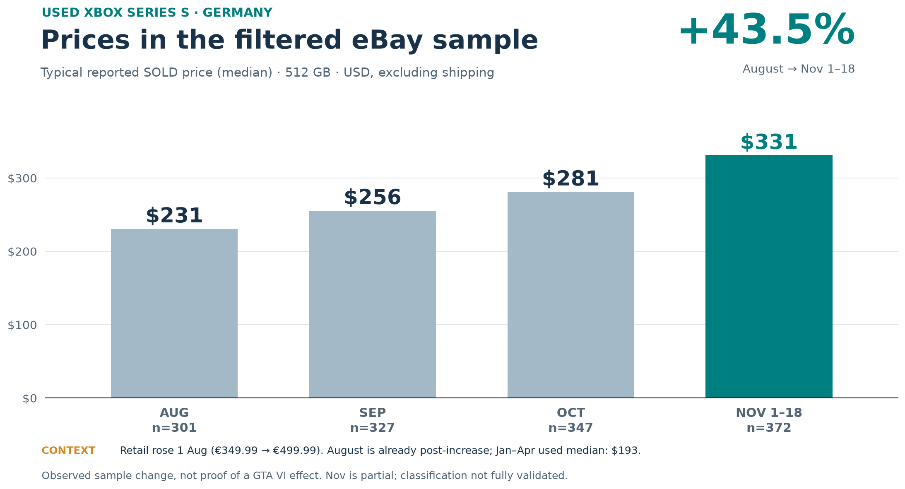
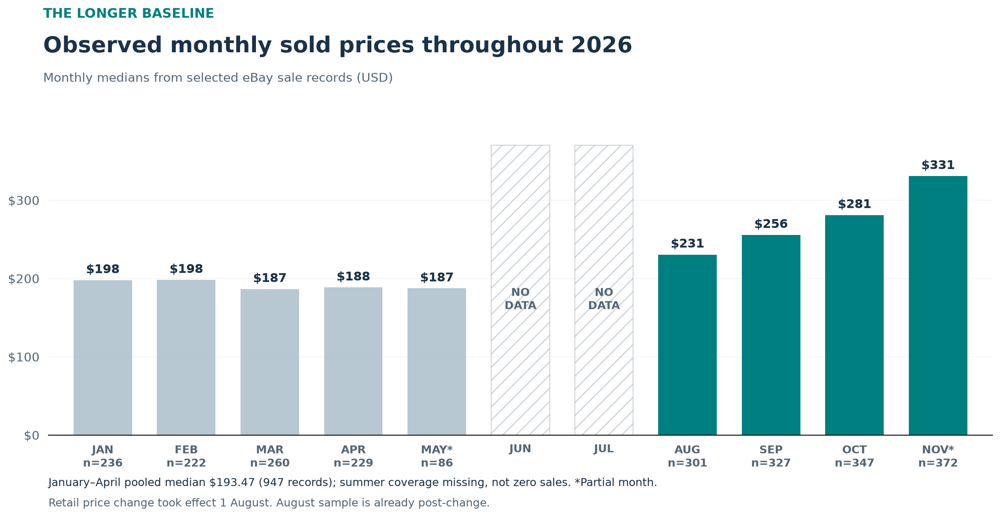
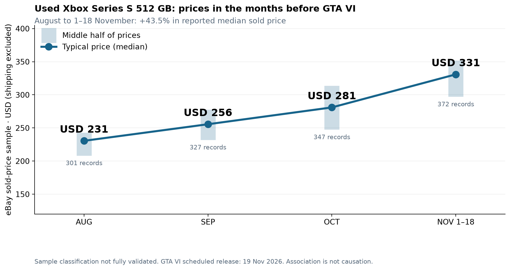
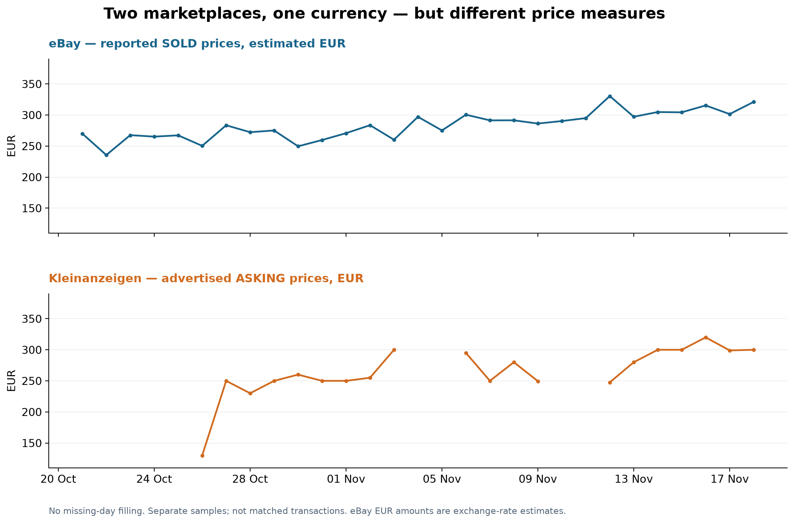

# Used Xbox Series S prices in Germany: an exploratory 2026 study

**Independent Python marketplace analysis · Historical data through 18 November 2026**

## The finding in five seconds

In a filtered third-party eBay Germany sample, the **median reported SOLD price** of a used Xbox Series S 512 GB increased from **$230.54 in August (n=301)** to **$330.81 during 1–18 November (n=372)**: an **observed +43.5%**. USD is the source-reported currency; shipping excluded.



**Critical context:** Microsoft raised the German **NEW** Xbox Series S 512 GB retail price **€349.99 → €499.99 (+42.9%)**, effective **1 August 2026**. [Microsoft announced the worldwide change](https://news.xbox.com/en-us/2026/06/25/xbox-console-price-update/) and [ComputerBase documented the German prices](https://www.computerbase.de/news/gaming/spielkonsole-xbox-series-x-s-kostet-jetzt-bis-zu-weitere-200-euro-mehr.98679/). **Our August eBay baseline is already after that change.** The numerical resemblance between +42.9% retail and +43.5% observed resale does **not** identify a causal effect; resale prices continued rising from August through November. GTA VI released on **19 November 2026**, one day *after* the dataset's final observation. [Rockstar release-time confirmation](https://support.rockstargames.com/articles/29jV3Cv2cCgvwM1XgtMO5o/grand-theft-auto-vi-regional-pre-load-and-release-times-on-playstation-5-and-xbox-series-x-or-s).

## Don't overlook the earlier baseline

January–April 2026 had a pooled median eBay reported sold price of **$193.47 (947 filtered records)**, compared with **$330.81** in November 1–18 (**about +71%**). Individual January–May monthly medians were roughly $187–198.

**There is no usable June or July observation**, and May is incomplete. We cannot establish *when* prices moved through that gap or separate the effect of retail pricing from GTA VI anticipation, seasonality or a change in the listings collected.



## Price spread and uncertainty

The middle half of eBay filtered sold prices moved from **$208.26–$242.74** in August to **$297.09–$351.85** in November 1–18. These are **25th–75th percentile ranges**, not confidence intervals. A *whole-observed-day* bootstrap gives an approximate **95% interval of +41% to +49%** for the observed USD median increase, conditional on the collected sample and the day-resampling assumptions; it does **not** address selection bias, dependence between adjacent days or misclassified items.



A separate [daily eBay USD trend](figures/final_eBay_USD_prelaunch_trend.png) shows all **110 observed days from 1 August to 18 November**, with the 19 November release shown only as an event marker after the data ends.

## Accessible euro estimates (supplementary only)

eBay reports **USD SOLD prices** through the third-party provider. Historical European Central Bank daily reference rates were applied **to each sale's date** to estimate EUR; these are not verified original euro checkout amounts.

**eBay sold prices, estimated EUR**

| Period | Median estimated EUR | Filtered records |
|---|---:|---:|
| August 2026 | **€199.00** | 301 |
| November 1–18, 2026 | **€298.58** | 372 |

The estimated EUR change is **+50.0%** instead of +43.5% in USD because the historical USD/EUR exchange-rate movement affects the per-sale EUR conversions. Original USD results remain the headline.

**Kleinanzeigen advertised ASKING prices, actual EUR**

| Period | Median asking EUR | Listing-day observations |
|---|---:|---:|
| October 26–31, 2026 | €240 | 48 |
| November 1–18, 2026 | €290 | 237 |

**These are not the same periods or price measures.** Kleinanzeigen is weaker evidence: only **six observed baseline days**, no day verified complete, potential repeated listings, and substantially different results depending on how identical-value rows and classification flags are handled (approximately **+18% to +30%** in the tested versions). For this source, the defensible takeaway is that *observed asking prices were higher in November*, not a precise market-wide percentage.



[Exchange-rate methodology, rate tables and conversion CSVs](README_EUR_COMPARISON.md). **Converting both to EUR does not make asking prices equivalent to actual sold prices.**

## Quality checks and important limitations

- **Unverified console classification:** A secondary classifier disagreed with the inherited used-512 GB selector on 1,272 of 2,380 eBay records and 120 of 285 Kleinanzeigen observations. Those disagreements are not all proven false positives. When restricted to records the secondary classifier accepted, the eBay August–November increase remained approximately **+43.5%**.
- **Duplicate uncertainty:** The minimal audit extract contains **163 eBay and 64 Kleinanzeigen exact identical-value rows**. These may reflect repeat collection or genuinely equal prices; the exported fields lack transaction IDs sufficient to prove what is duplicated. They remain in the main sample **provisionally**; removing identical rows gives **eBay +43.2%** (vs +43.5%) and **Kleinanzeigen +30.2%** (vs +20.8%). Because Kleinanzeigen changes substantially, its point estimate must not be overinterpreted.
- **Sampling limitations:** eBay has **2,380 filtered records** out of 18,502 source records, with missing 8–9 May and **15 May–31 July**; Kleinanzeigen has **285 filtered listing-day observations** from 4,858 collected observations and missing 21–25 Oct, 4–5 Nov and 10–11 Nov. None of these samples is a verified census. Missing dates are never assigned fake prices.
- **No causal identification:** Retail replacement cost, promotional activity, seasonal demand, item condition, bundles, changing listing mix and selection by providers may explain some of the pattern. Similar percentage rises in retail and resale prices cannot be equated: the observed periods and currencies differ.

Full assumptions, duplicates and bootstrap results: [statistical audit](STATISTICAL_AUDIT.md), [methodology](METHODOLOGY.md).

## Reproduce the published charts

Only **public, non-identifying aggregate tables** are needed. The original row-level records, API keys and seller details remain private.

```bash
python -m pip install -r requirements.txt
python public_visuals.py
python social_visuals.py
```

[`public_visuals.py`](public_visuals.py) generates the technical plots. [`social_visuals.py`](social_visuals.py) generates the simplified hero and full-year context and improves the supplementary EUR comparison. [`data/`](data) contains aggregates; [`figures/`](figures) contains the published graphics. **The scripts cannot recreate private row-level classification or statistical resampling from public aggregates alone.**

This is an independent observational study, not affiliated with Microsoft, Rockstar Games, eBay, Kleinanzeigen or the third-party data providers.
