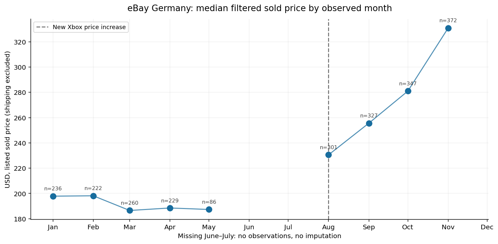
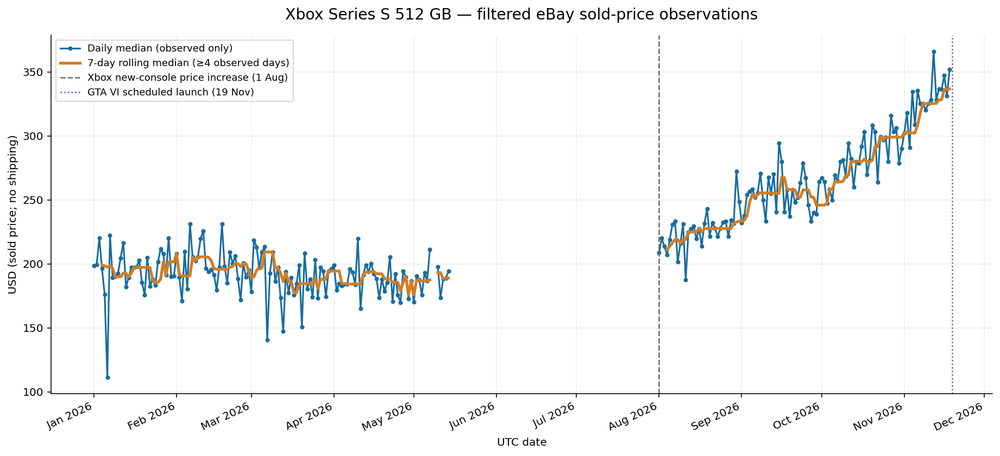
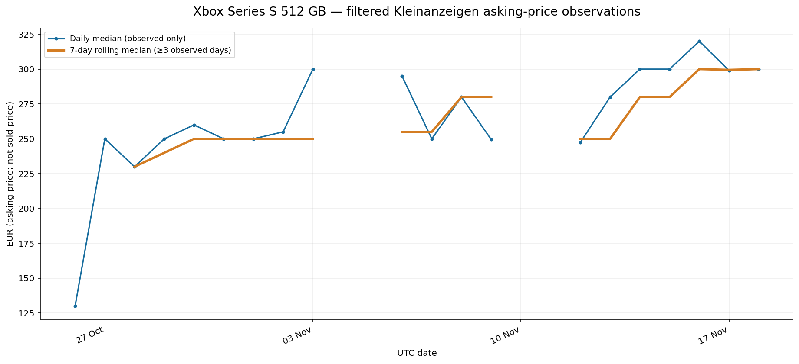

# Did GTA VI hype coincide with higher used Xbox Series S prices?

### An independent exploratory analysis of second-hand console prices in Germany (2026)

**Python · Web scraping / API data · Data cleaning · Time-series visualization · Missing-data analysis**

> **Main finding:** In the filtered third-party eBay Germany sample, the median reported sold price for a used Xbox Series S 512 GB rose from **$230.54 in August** to **$330.81 in November 1–18, 2026** (**+43.5%**). A shorter Kleinanzeigen sample also showed an increase in asking prices. These are observational associations—not evidence that *GTA VI* caused the change.



## Research question

**How did prices for used Xbox Series S 512 GB consoles change ahead of the scheduled 19 November 2026 launch of GTA VI?** To what extent might the price trajectory also reflect **Microsoft's August 2026 new-console price increase** or ordinary seasonal demand?

## Key results

| Source | Earlier median | Later median | Change | Comparable measurement |
|---|---:|---:|---:|---|
| eBay Germany (third-party dataset) | **$230.54**, Aug (n=301) | **$330.81**, Nov 1–18 (n=372) | **+43.5%** | Filtered, reported sold prices, USD; shipping excluded |
| Kleinanzeigen (third-party historical sample) | **€240**, Oct 26–31 (n=48) | **€290**, Nov 1–18 (n=237) | **+20.8%** | Filtered asking prices, EUR; *not* realized sales |

**Important:** The periods differ, the currencies differ, and one source measures sold prices while the other measures advertised asking prices. Do **not** pool them as a single price series or treat the two percentage changes as directly controlled comparisons.

### eBay: observed daily sales only



- **2,380** records selected by the project's inherited 512 GB / used-console filter, from **18,502** deduplicated third-party eBay records.
- **242** calendar days with selected records between 1 Jan and 18 Nov 2026.
- Entirely missing **8–9 May** and **15 May–31 July (78 consecutive days)**. These are **missing collection coverage**, not proof that zero consoles were sold.
- The **1 Aug–18 Nov** segment has observations on each of its **110 days**; it supports a more reliable descriptive *within-sample* trend than the May–July gap.
- eBay amounts are recorded in **USD by the third-party provider**, despite Germany site targeting. Do not assume these are EUR values or currency-adjusted.

### Kleinanzeigen: asking prices, not confirmed sales



- **285** filtered listing-day price observations, from **4,858** deduplicated historical records.
- 20 observed days between **26 Oct and 18 Nov 2026**.
- Missing 21–25 Oct, 4–5 Nov, 10–11 Nov; sampling completeness is **unverified even for days with records**.
- Listings can recur across snapshot days. Therefore, **285 observations are not necessarily 285 unique consoles**.

## Another major event: new Xbox pricing

Microsoft [announced a worldwide Xbox console price update on 25 June 2026, effective 1 August](https://news.xbox.com/en-us/2026/06/25/xbox-console-price-update/). German reporting documented a rise in the **Xbox Series S 512 GB recommended retail price from €349.99 to €499.99** (see [ComputerBase](https://www.computerbase.de/news/gaming/spielkonsole-xbox-series-x-s-kostet-jetzt-bis-zu-weitere-200-euro-mehr.98679/)). This is a plausible competing explanation for some of the rising second-hand prices. Rockstar's [19 November 2026 release announcement](https://www.rockstargames.com/newswire/article/ak3ak31a49a221/grand-theft-auto-vi-is-now-set-to-launch-november-19-2026) provides the study's pre-launch cutoff.

**This project does not isolate the causal impact of GTA VI.** Identifying a GTA-specific effect would require more controls, comparable products, longer pre-period coverage, post-launch observations and a design that addresses changes in new-console pricing and seasonality.

## Repository contents

```text
.
├── analyze.py                         # Offline, reproducible plot generation
├── data/
│   ├── ebay_daily_aggregated_USD.csv  # Calendar dates with sampled sold-price statistics
│   ├── ebay_monthly_aggregated_USD.csv# Monthly medians from individual selected sales
│   ├── kleinanzeigen_daily_aggregated_EUR.csv
│   ├── kleinanzeigen_monthly_aggregated_EUR.csv
│   └── kleinanzeigen_date_coverage.csv
├── figures/                           # Reproducible gap-safe price charts
├── METHODOLOGY.md                     # Sources, sample rules, gaps and limitations
├── FUTURE_RESEARCH.md                 # Next statistical steps
└── requirements.txt
```

**No API keys, live credentials, seller-level records, scraped HTML or raw provider responses are included.** Public CSVs contain only aggregated counts and prices. This repository reproduces the charts and summaries from those aggregates; it **does not reproduce the entire historical scraping or item-classification pipeline**.

## Reproduce the charts

Requires Python 3.10+.

```bash
python -m pip install -r requirements.txt
python analyze.py --check-only
python analyze.py
```

Outputs are saved in `figures/`. The script makes **no network/API calls** and costs **zero API credits**.

## Missing-data policy

Dates with no observations are represented by **missing values (NaN)**, with visible breaks in charts. A 7-calendar-day rolling median is computed **only from actually observed days**, requiring at least 4 observed days for eBay and 3 for Kleinanzeigen. It is displayed only where the underlying day has observations. **No global median filling, forward-fill or long-gap interpolation** is used. Full details are in [METHODOLOGY.md](METHODOLOGY.md).

## Limitations and data-quality warning

This is a personal, **exploratory** portfolio project. The third-party samples are not confirmed representative or exhaustive. More importantly, a secondary product classifier disagrees with some records in the inherited **“strict used 512 GB”** filter: **1,272 of 2,380 eBay strict records** have a secondary `is_series_s_console=False` flag; **120 of 285 Kleinanzeigen strict records** have a secondary `is_console=False` flag. Some are plausible false negatives (e.g., mention of included controllers), but this discrepancy **has not yet been fully resolved or independently hand-audited**. The reported increases are therefore **conditional on the inherited filter** and must not be treated as final validated market estimates. See [METHODOLOGY.md](METHODOLOGY.md) for details.

---

*Independent personal research project. Not affiliated with Rockstar Games, Microsoft, eBay, Kleinanzeigen or the third-party API providers. All trademarks belong to their owners.*
