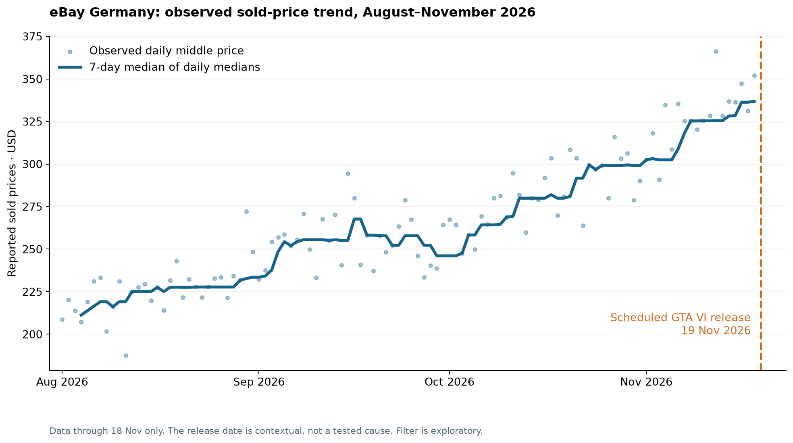

# Did used Xbox Series S prices rise before GTA VI?

**Independent Python data-analysis project | Germany | Research data through 18 November 2026**

I examined reported eBay Germany sold prices and Kleinanzeigen advertised prices for used Xbox Series S 512 GB consoles. The primary finding is an **observed increase in the eBay sample**, not proof that GTA VI caused the change.

## Main result: reported eBay sold prices

| Filtered eBay sample | August 2026 | November 1–18, 2026 |
|---|---:|---:|
| Typical reported sold price (median) | **$230.54** | **$330.81** |
| Middle 50% of prices (25th–75th percentile) | $208.26–$242.74 | $297.09–$351.85 |
| Records | 301 | 372 |

The observed median increased **43.5%**. A whole-observed-day bootstrap yields an approximate **95% interval of +41.0% to +48.7%**, *conditional on the collected sample and the resampling assumptions*. Neither the change nor that interval identifies a GTA VI causal effect or fixes provider sampling bias.


**How to read this:** A *median* is the middle observed price, not a prediction or an average of daily medians. The vertical shading shows where the middle half of filtered prices fell. November contains only 1–18 November, and the product classifier has not been independently hand-validated.

## Timeline toward the scheduled GTA VI release

The series below includes **110 consecutive observed dates from 1 August through 18 November 2026**. The scheduled GTA VI release date, **19 November 2026**, is shown only as context, after the last observation. The smoothed line is a *seven-calendar-day median of daily medians*, not a median over the individual sales in each seven-day window.



## Side-by-side prices in euros

eBay's third-party provider reported USD amounts. For accessibility to German readers, I also estimate their EUR equivalents using **historical ECB USD-per-EUR rates applied by sale date**. The estimated EUR numbers are **not verified original checkout amounts**.

| Source and measure | Earlier period | November 1–18 |
|---|---:|---:|
| eBay reported **sold** prices, estimated EUR | **€199.00** (August, n=301) | **€298.58** (n=372) |
| Kleinanzeigen **asking** prices, EUR | **€240** (October 26–31, n=48) | **€290** (n=237) |

**The dates, listings and price types differ.** Currency conversion does not make eBay sold prices equivalent to Kleinanzeigen advertised prices; these figures must not be interpreted as matched transactions or a controlled comparison. The estimated EUR eBay change over August–November was +50.0%; the change differs from USD partly because the exchange rate moved.


More details and historical rates: [EUR conversion methodology](README_EUR_COMPARISON.md). The original USD charts and input aggregates remain in this repository.

## Statistical checks and uncertainty

- **Sample:** 18,502 deduplicated *source* eBay records, of which 2,380 met the inherited used-512 GB filter. Kleinanzeigen: 4,858 source observations and 285 filtered **listing-day** observations, not necessarily unique consoles.
- **Exact-value repeats:** 163 eBay filtered rows and 64 Kleinanzeigen filtered rows share identical values in the minimal exported fields. Those fields cannot establish duplicate *transactions*. They are retained in the main analysis; removing them changes the eBay increase **43.5% → 43.2%** but moves Kleinanzeigen **20.8% → 30.2%**.
- **Alternative classification:** Keeping only records approved by a separate console classifier gives approximately **+43.5%** for eBay, but the classifiers disagree frequently and neither has been fully manually audited.
- **Missing days:** eBay has no observed records on **8–9 May** and **15 May–31 July**; Kleinanzeigen lacks **21–25 October, 4–5 November and 10–11 November**. These dates are **missing coverage, not zero sales**; no values were imputed. Days with data are not guaranteed to be complete market samples.
- **Sampling and time dependence:** The bootstrap resampled whole observed days separately in each period (6,000 draws, fixed seed 20261119) but does not account for correlation between adjacent days, changes in collection effort, item-mix shifts, possible reobservations, selection bias, or exchange-rate-provider uncertainty. The Kleinanzeigen interval is particularly unstable because its baseline comprises just six observed days.
- **Other explanations:** Microsoft's 2026 new-console retail pricing, seasonality, general electronics resale demand, and differing bundles or item condition could all affect the observed changes. See [methodology and limitations](METHODOLOGY.md).

## Reproduce public charts without an API key

The following uses **only published aggregate CSV files**—no seller details or row-level sale records—and regenerates the three featured charts.

```bash
python -m pip install -r requirements.txt
python public_visuals.py
```

Additional analysis: `python analyze.py` regenerates earlier historical charts; `python fx_comparison.py` regenerates the prior EUR figures. The published monthly quartile table is a *derived aggregate* from private row-level data; charts reproduce those published aggregates, **not the private scraping or classification workflow**.

## Repository contents

- [`public_visuals.py`](public_visuals.py): featured public visualization code
- [`data/`](data): aggregated pricing and historical EUR conversion data
- [`figures/`](figures): ready-to-share charts
- [`README_EUR_COMPARISON.md`](README_EUR_COMPARISON.md): currency conversion and comparison details
- [`METHODOLOGY.md`](METHODOLOGY.md) and [`FUTURE_RESEARCH.md`](FUTURE_RESEARCH.md): research limitations and future controls

**This is a personal exploratory study.** No API keys, seller-identifying information or raw provider listings are intentionally published. This project is not affiliated with Rockstar Games, Microsoft, eBay, Kleinanzeigen or the data providers.
