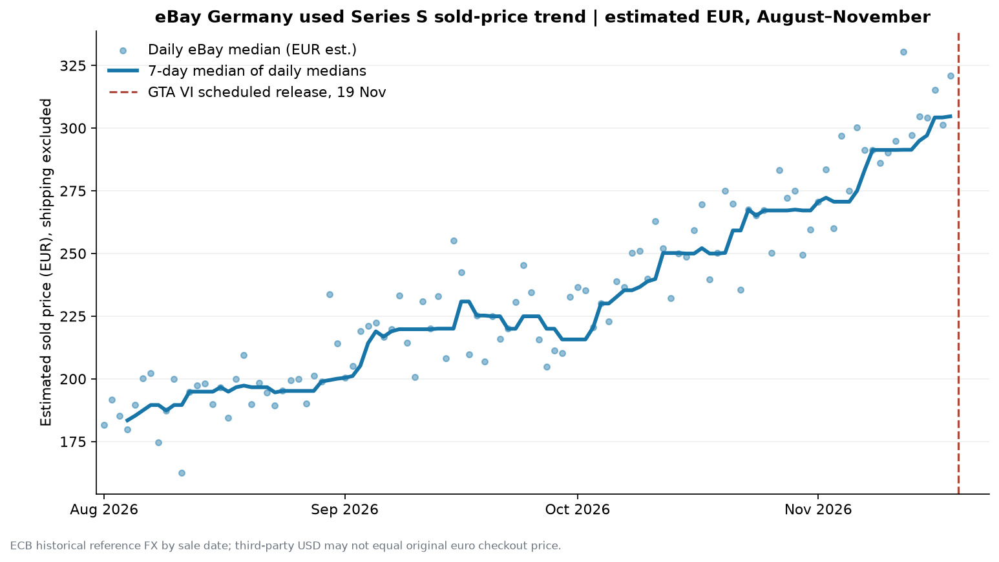
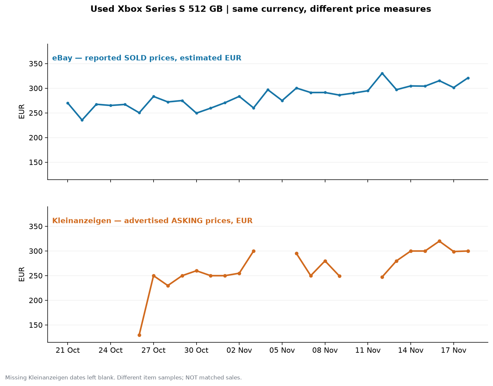
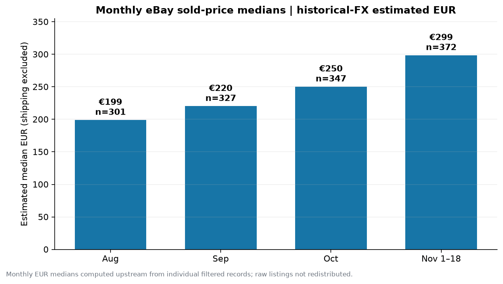

# Same-currency comparison: eBay versus Kleinanzeigen (EUR)

The original third-party eBay Germany data records **reported SOLD prices in USD**, whereas Kleinanzeigen has **advertised ASKING prices in EUR**. This supplement converts eBay values using historical ECB EUR/USD reference rates for each calendar date. On weekends, the last previously published reference rate is used. It improves **currency comparability only**, not equivalence of transaction type or sample composition.

| Month (2026) | eBay filtered records | Original median USD | Estimated record-level median EUR |
|---|---:|---:|---:|
| August | 301 | $230.54 | €199.00 |
| September | 327 | $255.58 | €220.31 |
| October | 347 | $280.96 | €250.30 |
| November 1–18 | 372 | $330.81 | €298.58 |

Observed Aug–Nov median change is **+43.5% in reported USD** and **+50.0% in estimated EUR**. These calculations are descriptive, not evidence GTA VI caused the increase.

**Identical-window descriptive comparisons** (different price types, not matched transactions):
- Oct 26–31: eBay estimated sold-price median €259.80 (n=64); Kleinanzeigen asking median €240 (n=48 listing-day records).
- Nov 1–18: eBay estimated sold median €298.58 (n=372); Kleinanzeigen asking median €290 (n=237 listing-day records).
- Kleinanzeigen has missing days (Oct 21–25, Nov 4–5 and Nov 10–11). Do not fill them with zero or a guessed median.

**Formula:** `estimated EUR = third-party reported USD / ECB USD per EUR`. On ECB non-publication dates use the most recent rate published on or before the observation. No currency conversion recovers actual original EUR transaction values when the provider's USD values have already undergone prior normalization. Shipping excluded.

**Audit trail:** [ECB reference-rate table](data/ECB_USD_per_EUR_reference_rates.csv), [eBay converted daily aggregates](data/ebay_daily_estimated_EUR.csv), [common calendar dates](data/shared_dates_EUR_comparison.csv), and [upstream record-level monthly *aggregate* medians](data/ebay_monthly_EUR_record_level_aggregates.csv). The *daily* conversion and all charts can be reproduced with `python fx_comparison.py`. Monthly EUR medians were calculated from private row-level records and therefore **cannot** be recreated by taking medians of public daily medians.

**Sources:** [ECB historical EUR/USD calendar](https://www.ecb.europa.eu/stats/policy_and_exchange_rates/euro_reference_exchange_rates/html/eurofxref-graph-usd.en.html) and [ECB rates](https://www.ecb.europa.eu/stats/policy_and_exchange_rates/euro_reference_exchange_rates/html/index.en.html). Original used-512 GB product classification is not fully audited; no raw seller data is included.
